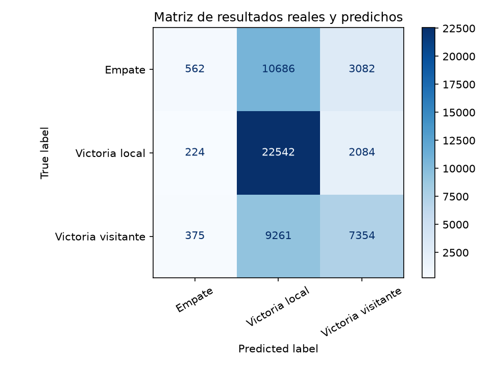
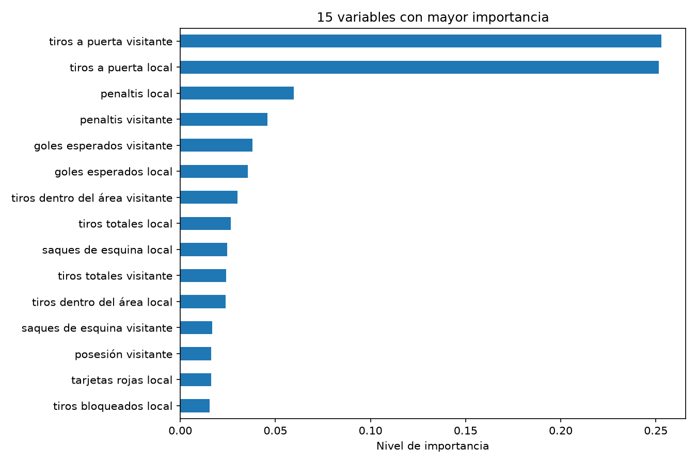

# Análisis de partidos de fútbol

## 1. Datos del estudiante y la institución

- **Estudiante:** José David Cardona Mazo
- **Institución:** IU Digital de Antioquia
- **Docente:** Andrés Felipe Callejas
- **Curso:** Aprendizaje Automático

## 2. EA1: carga y preparación de datos

`HFDatasetLoader` carga los datos de Hugging Face y los convierte en una tabla
de Pandas. `DatasetSummarizer` crea un informe con sus columnas, valores
faltantes y estadísticas. Estas clases de EA1 se conservaron intactas.

El cuaderno `notebook.ipynb` carga `match_stats` y aplica cuatro
transformaciones: renombra columnas, selecciona las estadísticas necesarias,
elimina filas sin identificador o sin datos de tiros y calcula los tiros
totales del partido. Después genera `resumen_match_stats_transformado.txt`
con el mismo DataFrame transformado.

## 3. EA2: análisis y hallazgos

### Pregunta de negocio

> ¿Qué estadísticas de un partido, como posesión, tiros a puerta y faltas, se
> relacionan más con la victoria de un equipo?

El análisis está dirigido al cuerpo técnico para apoyar la revisión de partidos
y la planificación de entrenamientos. No demuestra que una estadística cause
una victoria ni reemplaza el criterio técnico.

**Dataset:** [`eatpizzanot/soccer-dataset` en Hugging Face](https://huggingface.co/datasets/eatpizzanot/soccer-dataset),
configuración `match_stats`, división `train`. Esta tabla contiene estadísticas
de partidos, pero no el marcador final; el programa obtiene los goles y el
estado de la configuración `fixtures` y enlaza las tablas mediante
`fixture_id`. Solo conserva partidos finalizados con goles disponibles.

La variable objetivo se construye comparando los goles finales: victoria local,
empate o victoria visitante. Esos goles, el identificador y los goles al
descanso no se usan como predictores. Se utilizan 28 estadísticas: tiros,
remates a puerta, tiros dentro y fuera del área, tiros bloqueados, penaltis,
saques de esquina, tarjetas, goles esperados, posesión, faltas, fueras de juego
y precisión de pases, tanto del equipo local como del visitante.

Los datos describen el partido completo. Por eso el análisis es retrospectivo:
clasifica resultados ya ocurridos y ayuda a revisar partidos y planear
entrenamientos; **no** predice el resultado en vivo ni antes del encuentro.
La exclusividad del conjunto frente a otros grupos debe confirmarse con el
docente; no se puede verificar solo desde este repositorio.

### Modelo

Es un aprendizaje supervisado de clasificación: el conjunto ya tiene la
respuesta conocida (el resultado final). Se usa un bosque aleatorio:

1. Cada uno de sus 100 árboles recibe una muestra de partidos y estadísticas.
2. Los árboles aprenden reglas que separan victorias locales, empates y
   victorias visitantes.
3. Para cada partido de prueba, cada árbol vota por una clase.
4. El bosque devuelve la clase con más votos.

- `n_estimators=100`: cantidad de árboles.
- `max_depth=10`: profundidad máxima de cada árbol.
- `random_state=42`: permite repetir el experimento.

Antes del ajuste final, se comparan configuraciones de 50 árboles con
profundidades de 5, 10 y 15, además de 100 árboles con profundidad 10. La
comparación usa una muestra de validación tomada del conjunto de entrenamiento
y la medida F1 ponderada; el conjunto de prueba se reserva para la evaluación
final. La tabla automática de estas comparaciones está en
[`resumen_ejecucion.txt`](./outputs/resumen_ejecucion.txt). Se conserva la
configuración solicitada de 100 árboles y profundidad 10. En la validación,
50 árboles y profundidad 10 obtuvieron F1 0,4637; 100 árboles y profundidad
10 obtuvieron 0,4642. La mejora fue pequeña (0,0005), pero se conserva la
configuración solicitada de 100 árboles. La profundidad 15 logró 0,4783 en
esta muestra; se mantiene profundidad 10 como una alternativa menos compleja,
no como la mejor F1 observada. Los árboles pueden capturar relaciones no
lineales y no requieren estandarizar las variables; el escalado se mantiene
en este ejercicio, aunque no es necesario para este algoritmo. Sus
limitaciones son la dificultad para explicar cada predicción, el desbalance
de clases y que la importancia no demuestra causalidad.

### Preparación y resultados

Los datos se dividen de forma estratificada en entrenamiento (80 %) y prueba
(20 %), conservando la proporción entre las tres clases. Los valores faltantes
se reemplazan por la mediana y las variables se estandarizan. Ambos ajustes se
aprenden solo del conjunto de entrenamiento y después se aplican al de prueba.
La comparación de parámetros también se hace dentro del conjunto de
entrenamiento, sin seleccionar parámetros con el conjunto de prueba.

| Medida | Resultado |
|---|---:|
| Exactitud | 54,22 % |
| Precisión ponderada | 53,59 % |
| Sensibilidad ponderada | 54,22 % |
| Medida F1 ponderada | 46,55 % |

La exactitud supera la referencia de 44,24 % que se obtendría al elegir siempre
la clase más frecuente. La F1 ponderada es menor que la exactitud porque el
rendimiento difiere entre clases. La matriz de confusión generada por el
programa presenta los aciertos en la diagonal y los errores fuera de ella:



El modelo reconoce el 90,7 % de las victorias locales, pero solo el 3,9 % de
los empates; confunde muchos empates y victorias visitantes con victorias
locales. Por ello, no se recomienda usarlo como única base para decidir una
táctica.

En la importancia de variables destacan los tiros a puerta del visitante
(0,2529) y del local (0,2515). Les siguen los penaltis local (0,0597) y
visitante (0,0458). La posesión no está entre las variables más importantes.
La gráfica de importancia se genera en cada ejecución:



Estos resultados orientan preguntas para el análisis táctico, no son reglas
causales. Son una primera referencia experimental, no evidencia suficiente
para una predicción confiable de partidos futuros: los datos son retrospectivos
y el reconocimiento de empates es muy bajo.

### Recomendaciones

1. Practicar remates precisos y revisar cómo se permite al rival llegar a
   posiciones de tiro.
2. Analizar las acciones que terminan en penalti para detectar oportunidades
   de mejorar la defensa.
3. Revisar la calidad de las ocasiones creadas y concedidas, en especial las
   que se producen dentro del área.

Las recomendaciones son hipótesis para el cuerpo técnico: el modelo comete
errores importantes y usa estadísticas de partidos completos.

### Ejecución

**Para ejecutar EA1:** abre `notebook.ipynb` en VS Code o Jupyter y ejecuta
todas las celdas, en orden. El archivo
`resumen_match_stats_transformado.txt` debe quedar en la carpeta principal.

**Para ejecutar EA2**, desde la carpeta del proyecto:

```bash
python -m pip install -r requirements.txt
python main.py
```

El programa guarda en `outputs/` `confusion_matrix.png` (resultados reales y
estimados), `feature_importance.png` (importancia de las variables) y
`resumen_ejecucion.txt`. Este informe de EA2 es independiente del resumen de
EA1 generado por el cuaderno.

GitHub Actions ejecuta el programa al publicar cambios. Para descargar los
resultados, abre **Acciones**, selecciona una ejecución terminada y descarga
el archivo `resultados-analisis`. El resumen también se guarda en la raíz y en
`outputs/`. Antes de entregar, publica los cambios y verifica que exista una
ejecución exitosa; el historial y las ejecuciones del repositorio remoto aún
deben comprobarse.
